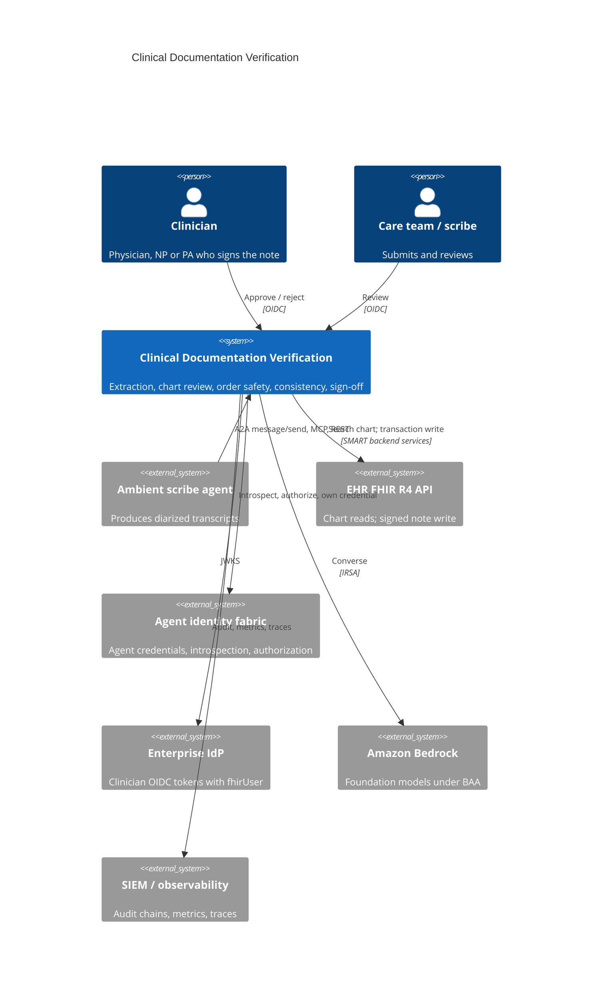
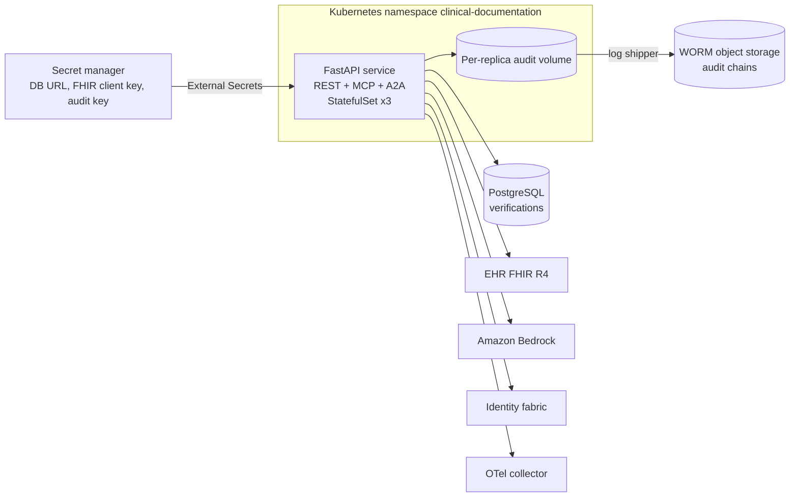
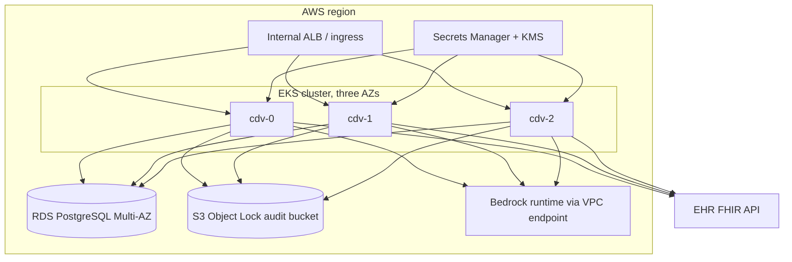

# Architecture

## Business problem

Ambient scribes and documentation agents now draft a large share of encounter
notes. Drafting is not the hard part; trusting the draft is. A generated note
can carry a dose the clinician never said, a problem the patient denied, an
order that conflicts with a documented allergy, or a medication list that
silently disagrees with the chart. Clinicians sign under time pressure, and a
signed note becomes the legal record that downstream billing, care
coordination and other agents rely on.

This service sits between the transcript and the chart. It turns the
conversation into structured, cited facts, checks them against the patient's
FHIR record and against medication-safety rules, scores how far the draft can
be trusted, and makes the signing clinician look at exactly what needs a
decision. It never writes to the chart on its own authority.

## System context (C4 level 1)



## Containers (C4 level 2)



## Components (C4 level 3)

| Layer | Module | Responsibility |
|---|---|---|
| API | `api.routes`, `api.app` | REST contract, OAuth-style errors, correlation IDs, metrics, `nosniff`, `no-store` |
| API | `api.mcp_server` | MCP tools (official SDK `MCPServer`, stateless streamable HTTP, JSON responses) |
| API | `api.a2a` | Agent Card, JSON-RPC `message/send`, `tasks/get`, `tasks/cancel` |
| Application | `application.service.VerificationService` | Workflow, sign-off state machine, policy calls, audit of every outcome |
| Orchestration | `orchestration.extraction_agent` | Bedrock extraction: guard, schema, corrective retry, normalization |
| Clinical | `clinical.segmentation`, `negation`, `extraction`, `sig`, `formulary`, `lexicon`, `grounding`, `reconciliation`, `orders`, `consistency`, `note` | Deterministic clinical logic; no I/O |
| Integrations | `integrations.fhir`, `fhir_documents`, `identity` | FHIR client and mapping, SMART auth, DocumentReference/Provenance builders, fabric client |
| Security | `security.principals`, `authorization`, `jwks` | Clinician and agent authentication, combined policy decisions |
| Infrastructure | `infrastructure.database` | SQLAlchemy Core repository, optimistic concurrency, idempotency keys |
| Runtime | `runtime.container` | Composition root |

## Sequences

### Verification

```mermaid
sequenceDiagram
  participant S as Scribe agent
  participant V as Verification service
  participant F as Identity fabric
  participant B as Bedrock
  participant E as EHR FHIR
  S->>V: A2A message/send (transcript, patient, encounter) + fabric credential
  V->>F: introspect, authorize documentation:verify
  V->>V: segment by speaker and section
  V->>V: rule-based extraction (always)
  V->>B: guarded, schema-constrained extraction (if configured)
  V->>V: validate JSON, retry with errors, ground citations, cross-check
  V->>E: Patient read; Condition, MedicationRequest, AllergyIntolerance search (paged)
  V->>V: chart diff, order safety rules, consistency score, draft note
  V->>V: policy fhir:write:DocumentReference -> require_approval
  V-->>S: Task input-required (summary, findings, draft note)
```

### Sign-off and authorized update

```mermaid
sequenceDiagram
  participant C as Clinician
  participant V as Verification service
  participant F as Identity fabric
  participant E as EHR FHIR
  C->>V: POST approve (attestation, override reason if critical) + OIDC token with fhirUser
  V->>V: policy documentation:approve (roles, Practitioner identity, critical findings, band)
  V->>V: status approved (optimistic lock), audit
  V->>F: own credential (jwt-bearer); authorize fhir:write:DocumentReference
  V->>E: transaction: DocumentReference (ifNoneExist identifier) + Provenance
  E-->>V: locations
  V->>V: status written, audit
  V-->>C: written; DocumentReference reference
```

A failed write leaves the verification `approved`; approving again retries the
write, and the conditional create makes the retry idempotent.

## Deployment view (AWS reference)



Azure (AKS, PostgreSQL Flexible Server, Key Vault, immutable Blob storage) and
GCP (GKE, Cloud SQL, Secret Manager, retention-locked GCS) variants are in
`deployments/terraform/azure` and `gcp`; on those clouds the providers file
lists the cloud's own BAA-covered models instead of Bedrock.

## MCP integration

`/mcp` serves the official MCP Python SDK server in stateless streamable-HTTP
mode with JSON responses, so any replica can serve any call. Tools have
Pydantic input and output schemas (published in `tools/list`). Each call
authenticates the caller from the `Authorization` header, runs through the
same application service and policy as REST, emits
`cdv_mcp_tool_calls_total{tool,outcome}` and writes an `mcp.tool.<name>` audit
event. Failures return MCP tool errors (`isError: true`) with the error code,
never stack traces. There is no MCP tool that approves or writes.

## A2A communication

The Agent Card (`/.well-known/agent-card.json`) advertises one skill,
`verify-clinical-documentation`, JSON-RPC transport at `/a2a`, and two
security schemes (fabric bearer credential for agents, OIDC for clinicians).
`message/send` accepts a data part (`patient_id`, `encounter_id`,
`transcript`) or a text part with identifiers in metadata. The message ID is
the idempotency key, so a retried send returns the same task. Task states map
to the sign-off workflow: `input-required` (awaiting clinician), `working`
(approved, write in progress), `completed` (written), `rejected`. `tasks/cancel`
returns `TaskNotCancelable`: only a clinician closes a verification.

## Observability

- Metrics (own registry, `/metrics`): request latency by route, verifications
  by band and extraction source, consistency histogram, findings by rule and
  severity, chart diff by kind, model fallbacks, clinician decisions and
  overrides, chart writes, MCP and A2A calls. GenAI token and cost metrics come
  from the agentic-core `ModelTelemetryObserver`.
- Traces: OpenTelemetry FastAPI instrumentation, OTLP export.
- Logs: structured JSON with correlation IDs; sensitive keys scrubbed.
- Alerts: `configs/prometheus/alerts.yaml` (SLO burn, FHIR outage, write
  failures, model fallback, critical-finding spikes, override rate, injection).
- Dashboard: `configs/grafana/clinical-documentation-verification.json`.

## CI/CD

`ci.yml` runs on every push and pull request: ruff, black, mypy `--strict`,
bandit, contract drift, all test suites with a 90% coverage gate on Python 3.12
and 3.13; PostgreSQL integration; Helm lint, required-value check, kubeconform;
Terraform fmt/validate for three clouds; Trivy IaC scan; container build, smoke
test (REST, Agent Card, MCP), Trivy image scan, Syft SBOM, Grype gate; Semgrep.
`release.yml` on a `v*` tag re-runs the gates, checks versions, pushes the
image to GHCR with provenance attestation, pushes the chart as an OCI artifact
and publishes a GitHub release with the SBOM.

## Data

| Store | Data | Classification | Retention |
|---|---|---|---|
| PostgreSQL `verifications` | Transcript utterances, extraction, chart snapshot, findings, draft and signed note | RESTRICTED (PHI) | Per organizational record policy; purge after the signed note is in the EHR |
| Audit chains | Actor, action, outcome, policy digest, IDs; no clinical content | CONFIDENTIAL | 7 years, WORM |
| EHR | Signed DocumentReference + Provenance | Legal record | EHR policy |

## Cost and scalability

Rule-based work is CPU-bound and fast (tests budget a 150-utterance visit at
under 1.5 s end to end on a CI runner). The cost driver is model extraction:
one Bedrock call per verification plus at most two corrective retries,
bounded by `extraction_max_tokens`. Spend is visible per model through
`agentic.model.cost`. Replicas are stateless apart from their audit volume; the
HPA scales on CPU and PostgreSQL is the shared state. FHIR search uses
`_count=100` and at most 20 pages per resource type.

## Acceptance criteria

1. No path writes to the EHR without a recorded clinician approval (tests:
   `test_t4_agent_cannot_sign_or_write`, `test_write_requires_service_permission`).
2. Critical findings block signing unless an override reason is given.
3. Every extracted item carries citations; unsupported model output is visible
   and penalized.
4. Orders are screened against the rule set in `docs/clinical/safety-rules.md`.
5. A retried write produces exactly one DocumentReference.
6. Every decision and state change is in a verifiable signed audit chain.
7. `git clone && uv sync && make check` passes with no keys or services.
